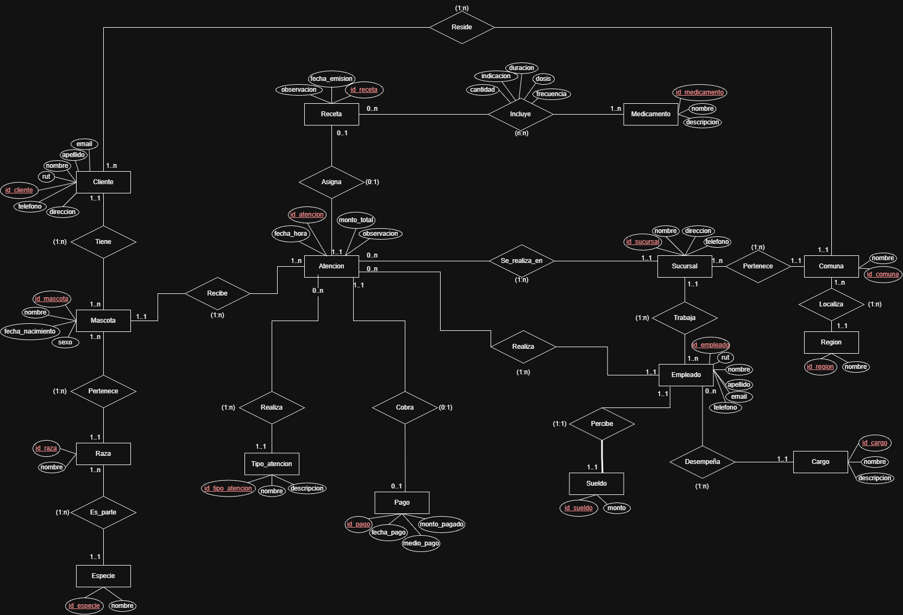

# Control 1 — Grupo 5

## Base de datos: veterinaria

## Integrantes

- Leandro Landeros
- Sebastian Macedo
- Lucas Huenuqueo
- Angelo Ulloa
- Vicente Rojas

## Diagrama MER

## Archivos

- [Crear la base de datos](dbCreate.sql)
- [Cargar datos](loadData.sql)
- [Consultas](runStatements.sql)
- [Diccionario de datos](Diccionario_de_datos_control_1_grupo5.pdf)
